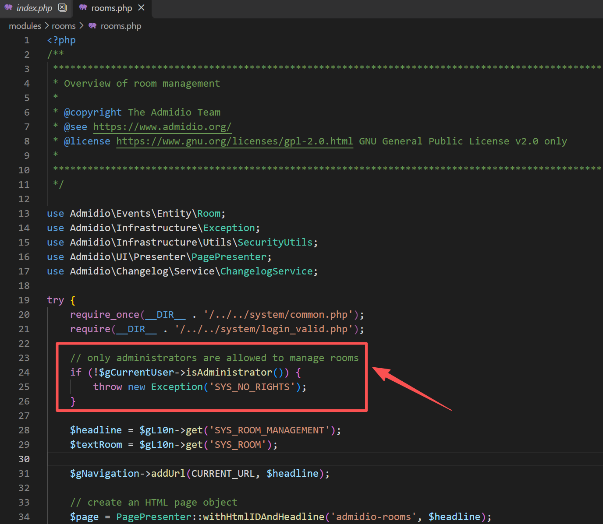
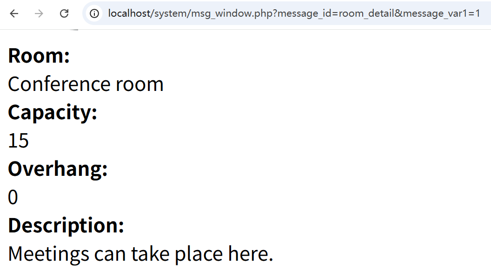

# Unauthenticated Disclosure of Room Details via the `room_detail` Message Endpoint

## Summary

In Admidio 5.0.17, a visitor does **not need to log in** to access room information through the `room_detail` branch of `system/msg_window.php`. An unauthenticated remote user can supply a numeric room ID and retrieve the room name, capacity, overhang, and description. This can expose non-public venue information when a site uses room records or descriptions for internal details.

## Affected products

- **Ecosystem:** Packagist
- **Package name:** `admidio/admidio`
- **Affected versions:** `5.0.17` (confirmed; other versions have not been verified)
- **Patched versions:** No patched version confirmed; leave this field unset until a fix is released

## Severity

- **Suggested severity:** Medium (conditional on limited confidentiality impact)
- **CVSS version:** 3.1
- **Vector:** `CVSS:3.1/AV:N/AC:L/PR:N/UI:N/S:U/C:L/I:N/A:N`

## Weaknesses

- **CWE-862:** Missing Authorization

## Details

`system/msg_window.php` includes `system/common.php` and validates the request parameters, but the `room_detail` branch does not require a valid login or check whether the requester may view the room or its associated event. When `message_var1` is numeric, it loads that room and renders its name, capacity, overhang, and description in the response (`system/msg_window.php:19-26, 40-61`). Numeric room IDs can be requested directly and enumerated.

The room management page applies stronger checks: `modules/rooms/rooms.php:21` includes `system/login_valid.php`, and lines 23-25 reject users who are not assigned the `Administrator` role. The role check is implemented by `User::isAdministrator()` (`src/Users/Entity/User.php:1503-1511`). This is evidence that room management is restricted; by itself it does not establish that room details are intended to be private.



The room popup is linked from event output in `modules/events/events.php:450-457`. The security impact therefore depends on the site's visibility policy: this endpoint is an authorization bypass if room details should be limited to authenticated users or to users allowed to view the associated event. If all room details are intentionally public, the observed response alone may not constitute a security vulnerability.

## Proof of concept

Tested against a local Admidio 5.0.17 deployment. Create or identify a room with a non-public value in its description, then follow these steps:

1. Open a private browsing window or otherwise make sure no Admidio session is active.
2. Request the following URL, replacing `1` with a valid room ID if necessary:

   ```text
   http://localhost/system/msg_window.php?message_id=room_detail&message_var1=1
   ```

3. Observe that the response contains the room name, capacity, overhang, and description without redirecting to the login page or returning an authorization error.



4. Change `message_var1` to other numeric room IDs to request their details.

Equivalent unauthenticated request:

```http
GET /system/msg_window.php?message_id=room_detail&message_var1=1 HTTP/1.1
Host: localhost
Connection: close
```

## Impact

An unauthenticated user can read room metadata by numeric ID. The demonstrated impact is limited to confidentiality and depends on whether the organization treats these details as private or restricts them through event visibility. No write access is demonstrated.